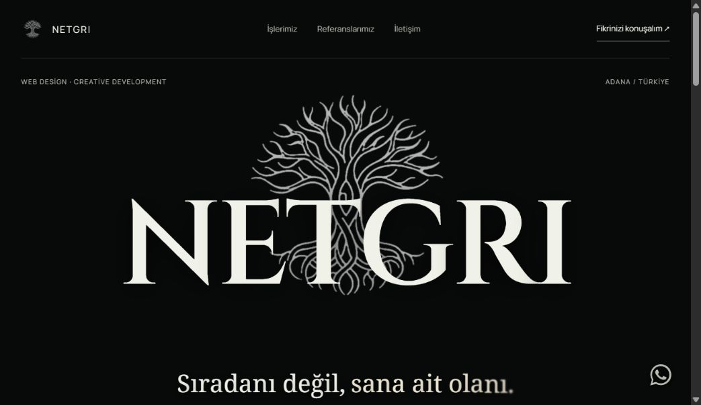

# NETGRI Portfolio

Web tasarım çalışmalarını animasyonlu bir proje vitriniyle sunan kişisel portföy sitesi.

**Yayın adresi:** [netgri.netlify.app](https://netgri.netlify.app/)

23 Kasım 2026 kontrolünde Netlify kullanım limiti nedeniyle yayın duraklatılmıştır.



## Ne yapıyor?

- Web projelerini görselleri ve canlı bağlantılarıyla sunar.
- Açılış, yazı ve proje gezinme animasyonları içerir.
- Telefon ekranına, klavye kullanımına ve azaltılmış hareket tercihine uyarlanır.
- Gizlilik tercihleri, paylaşım metaverileri ve 404 sayfası sunar.

## Kullanılan teknolojiler

HTML, CSS, JavaScript ve derleme için Node.js yerleşik modülleri. Yayın Netlify. Uygulama veritabanı veya yönetici girişi yoktur.

## Nasıl çalışır?

Node.js betiği kaynak HTML, CSS, JavaScript ve görselleri `dist/` klasörüne hazırlar. Dosya adlarına içerik özeti ekleyerek eski önbellekte kalan sürümleri önler. Proje kartları dış sitelere yönlendirir; iletişim formu veya mesaj toplayan sunucu yoktur. Gizlilik tercihi tarayıcıda saklanır; Analytics kimliği boş olduğu için takip varsayılan olarak kapalıdır.

Bu depoda kişisel telefon, e-posta ve sosyal profil bağlantıları örnek değerlerle değiştirilmiştir. Kendi yayının için `site.config.json` ve iletişim bağlantılarını düzenle. Canlı site önceki kişisel iletişim ayarlarını içerebilir.

## Çalıştırma

Node.js 22 veya üzeri; ek paket kurulumu gerekmez:

```sh
npm run check
npm run build
npm run preview
```

Önizleme: `http://127.0.0.1:4174`. Netlify `dist/` klasörünü yayımlar. Kendi alan adın için `SITE_URL` ortam değişkenini ayarla; kaynak yapılandırmasında adres boş bırakılmıştır.

## Doğrulama

Mevcut 5 test geçti; üretim derlemesi tamamlandı. Testler metaveri/önbellek, güvenlik başlıkları, çıktı dosyaları ve animasyon güncellemelerini kapsar.

## Yapay zekâ kullanımı

Yapay zekâ destekli geliştirme araçlarıyla geliştirildi. Tasarım, içerik, özellik kapsamı ve revizyonlar tarafımdan yönlendirildi; kod üretimi ve hata çözümünde bu araçlardan yararlanıldı. Aşağıdaki doğrulama notları bu GitHub sürümünün hazırlığına aittir.
